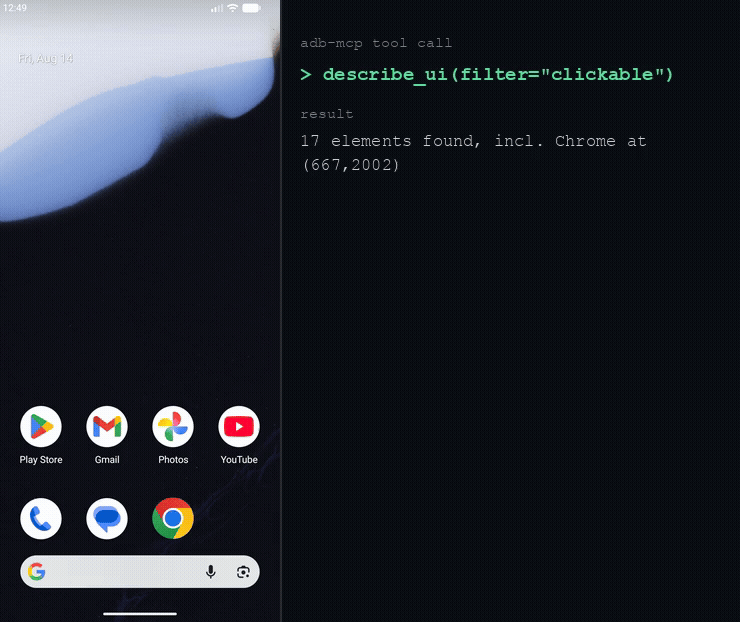

# adb-mcp Android skills

Guides that teach Claude how to drive an Android emulator or device with the
[adb-mcp](https://github.com/iksnerd/adb-mcp) server. Claude reads the real UI
hierarchy, taps by element instead of by guess, and checks each result before the
next step.

## The skills

| Skill | Use it when |
| --- | --- |
| `getting-started` | Starting an Android task, or no emulator is booted yet: list AVDs, boot one, target a device by serial |
| `driving` | Tapping, swiping or typing: the observe, locate, act, re-observe loop, with true-pixel coordinates and the traps that make taps miss |
| `rn-expo` | Driving a React Native or Expo dev build, or when code edits seem to have no effect on the device |
| `pin-and-lock` | Unlocking a device, entering a PIN on a native pad, or setting a lock screen that Keystore-backed code needs |
| `crash-triage` | An app crashes or shows a generic error: use logcat to find the real `Caused by:` |
| `build-and-test` | Building a Gradle variant, running JVM or on-device tests, or turning a JaCoCo report into the lines that need a test |

Each skill holds the full text of the matching guide that the server also serves as
an MCP resource. Some clients, Claude Desktop among them, do not read MCP resources,
so the skills carry the same text to them.

## This plugin has no server

The skills describe tools that the adb-mcp server provides. This plugin does not
start that server, run any program, download anything, or make any network request.
It is text only.

To get the tools, install the server separately and register it with Claude Code.
The [adb-mcp README](https://github.com/iksnerd/adb-mcp#getting-started) has the
steps and the Android SDK prerequisites. The server runs on your computer, so it works
in Claude Code and in Cowork sessions that run locally, not in claude.ai chat.

Without the server the skills still read as guides, but there is nothing for Claude to
call.

## Privacy and support

The plugin reads and sends nothing. The server's own data handling is described on the
[privacy page](https://adb-mcp.com/privacy). For help, see
[support](https://adb-mcp.com/support) or the [docs](https://adb-mcp.com/docs).

## License

MIT.
